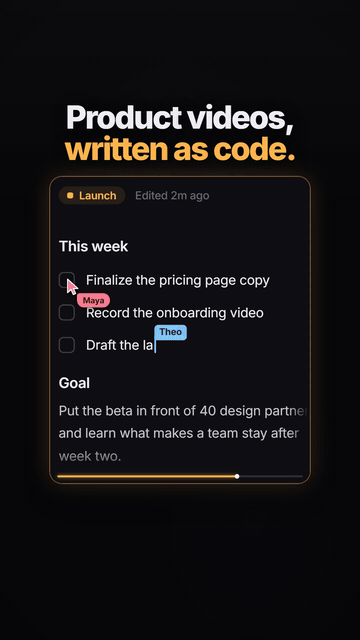
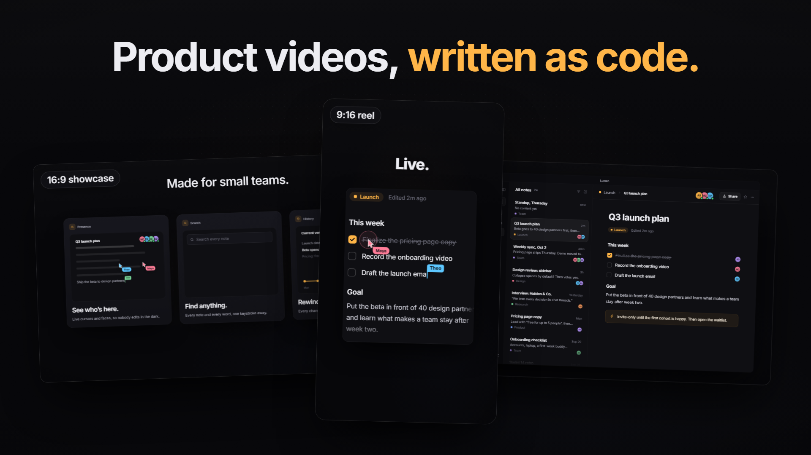
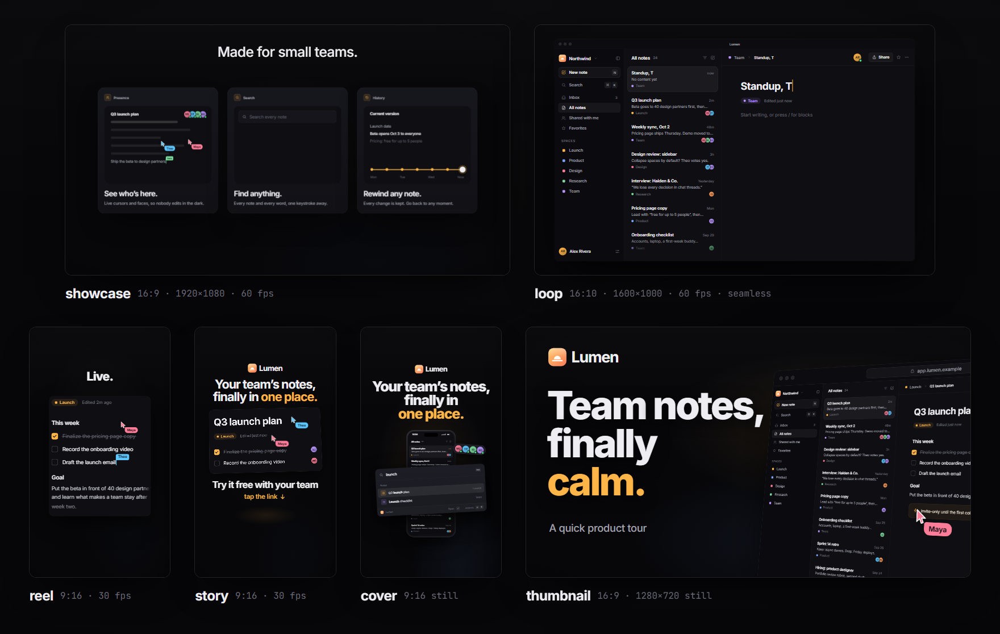

# motion-ui-videos

A Claude Code skill that makes product videos from your app's repo: reels, launch films, loops and covers. It rebuilds your real UI in code, then adds a cursor, captions and sound timed to the picture.

[Install](#install) · [Formats](#what-you-can-ask-for) · [Prompts](#first-prompts-to-try) · [How it works](#how-it-works) · [Limits](#requirements-and-limits)

<p align="center">
  
  <br><sub>This GIF is silent. <a href="https://github.com/dauletbekalim/motion-ui-videos/releases/latest/download/promo-reel-instagram-8mb.mp4">The reel with sound</a> is a 7.5 MB MP4.</sub>
</p>

## Quick start

In a Claude Code session:

```text
/plugin marketplace add dauletbekalim/motion-ui-videos
/plugin install motion-ui-videos@motion-ui-videos
```

Pick a scope when it asks. Then start Claude Code in your app's repo and ask for a video, for example "make a 20 second instagram reel for this app". [Install](#install) has the other ways in, and how to update or remove it.

The reel at the top is the skill's own promo, made the way it makes any video: from a copy of its template, with no screen recordings and no stock footage. Its source is in [`examples/skill-promo`](examples/skill-promo).

The skill is MIT. It renders with [Remotion](https://www.remotion.dev), which is free for individuals, non-profits and companies of up to 3 people; bigger companies need a [Remotion company license](https://www.remotion.dev/license).

<a href="https://github.com/dauletbekalim/motion-ui-videos/releases/latest/download/promo-showcase-youtube.mp4"></a>

[Download the 50 s launch film](https://github.com/dauletbekalim/motion-ui-videos/releases/latest/download/promo-showcase-youtube.mp4) (16:9, sound on, 27 MB MP4).

## What you can ask for

Tell it where the video will be posted; that sets the size, length and loudness.

- **A reel** for Instagram, TikTok or Shorts (9:16, 15–40 s): a hook on screen from the first frame, big captions a few words at a time, and one stretch that shows how the product works.
- **A launch film** for YouTube, your landing page or Product Hunt (16:9, about 45–120 s), paced for people who have never heard of you: one plain sentence per beat, each held long enough to read.
- **A feature clip** for a changelog or a feed (1:1, 4:5 or 16:9, 8–20 s): one new thing working.
- **A hero loop** for a landing page, docs or a README (4–10 s, muted), built so the last frame leads into the first, as a web MP4, WebM and GIF.
- **A story** (9:16, 5–15 s) with an empty spot for Instagram's link sticker and an arrow pointing at it.
- **An App Store or Google Play preview** (15–30 s), built on screen recordings you supply, since Apple allows only captures of the app. Captions, highlights and sound go on top; no cursor, no device frame. Google Play takes the video as a YouTube link.
- **Covers and thumbnails**: a reel cover that survives the 3:4 profile-grid crop, a YouTube thumbnail, OG images and banners, drawn with the same components as the video.

Can't decide? Ask for "all of it": a launch film, reel, story, cover and thumbnail from one project. Every video can then get a clean copy per platform (`instagram`, `tiktok`, `shorts`, `youtube`, `linkedin`, `x`, `gif`, `webm`) and caption files (`.srt`, `.vtt` and a transcript). Exact sizes, frame rates and loudness targets for each format are in [references/formats.md](skills/motion-ui-videos/references/formats.md).

<p align="center">
  
  <br><sub>The template's demo, a fictional notes app called Lumen, in every shape it ships with.</sub>
</p>

## Install

You need Claude Code on your own machine (terminal, desktop app or IDE), with Node 18.12+ and npm, and a connection for the first render. Cloud sessions, including claude.ai/code, don't load plugins or skills you installed on your machine.

**As a plugin.** In a Claude Code session:

```text
/plugin marketplace add dauletbekalim/motion-ui-videos
/plugin install motion-ui-videos@motion-ui-videos
```

The second command opens the plugin's details, where you pick a scope (you in every project, everyone on this repo, or you in this repo only) and install. If it asks, run `/reload-plugins`. The same from a shell:

```bash
claude plugin marketplace add dauletbekalim/motion-ui-videos
claude plugin install motion-ui-videos@motion-ui-videos
```

This installs it for you in every project. Add `--scope project` to turn it on for everyone on the repo; each teammate still runs the install once. It loads the next time you start Claude Code, or after `/reload-plugins`.

**As a plain skill.** Copy one folder:

```bash
git clone https://github.com/dauletbekalim/motion-ui-videos.git
mkdir -p ~/.claude/skills
cp -r motion-ui-videos/skills/motion-ui-videos ~/.claude/skills/
```

In PowerShell, the last two lines are:

```powershell
New-Item -ItemType Directory -Force $env:USERPROFILE\.claude\skills
Copy-Item -Recurse motion-ui-videos\skills\motion-ui-videos $env:USERPROFILE\.claude\skills\
```

That gives you the skill in every project. For one project (and its teammates, once committed), copy the folder into that repo's `.claude/skills/` instead. Claude Code picks up new skills without a restart; if the `skills` folder didn't exist when the session started, run `/reload-skills`.

**Using it.** Ask for a video in plain words and Claude loads the skill when the request fits. To call it by name, type `/motion-ui-videos` (as a plugin, its full name is `/motion-ui-videos:motion-ui-videos`).

### Update or remove

Marketplaces outside Anthropic's don't auto-update unless you turn it on in `/plugin`, on the Marketplaces tab. To update the plugin by hand:

```bash
claude plugin marketplace update motion-ui-videos
claude plugin update motion-ui-videos@motion-ui-videos
```

Then restart Claude Code or run `/reload-plugins`. An update only arrives when the version in [`.claude-plugin/plugin.json`](.claude-plugin/plugin.json) goes up.

To remove the plugin (add `--scope project` if you installed it for the repo):

```bash
claude plugin uninstall motion-ui-videos@motion-ui-videos
claude plugin marketplace remove motion-ui-videos   # optional: drops the marketplace too
```

To update the plain skill, run `git -C motion-ui-videos pull`, delete the old copy in `~/.claude/skills/`, and copy the folder again. To remove it, delete that copy: `rm -rf ~/.claude/skills/motion-ui-videos`, or `Remove-Item -Recurse -Force $env:USERPROFILE\.claude\skills\motion-ui-videos` in PowerShell.

Everything the skill makes for a project lives in that repo's `video/` folder. Delete the folder to remove it all.

## First prompts to try

Start Claude Code in your product's repo, so it can read your real components, copy and colors. It sets up the video as its own npm package in a `video/` folder, outside your app's build. Then ask in plain words:

- "make a 20 second instagram reel for this app"
- "make a 60 s launch video for our landing page and youtube. viewers have never heard of us."
- "i need a hero loop of the signup flow for our landing page, and a gif for the README"
- "make a 10 s changelog clip of the new export button"
- "here's a whoosh i like: ~/Downloads/whoosh.wav. make the video's sounds feel like that"
- "just write the script for a 30 s reel as a scene table. no video yet."

No app handy? Clone this repo and point it at the small fake expense app in [`evals/fixtures/tallybook`](evals/fixtures/tallybook):

- "make an instagram reel for tallybook (the repo is at evals/fixtures/tallybook). give me the mp4 and a cover image."

It shows you a scene table first, then stills, then a render, so you can steer while changes are cheap.

## Send a sound you like

Sounds are easier to show than describe. Send a whoosh, a click, a recording of your own keyboard or a clip whose sound you love. Claude measures it, tells you in plain words what it found, and builds the video's sounds from it. For the bundled [`evals/fixtures/refs/swoosh.wav`](evals/fixtures/refs/swoosh.wav), that's a soft swell that peaks at 0.24 s and is 40 dB down 280 ms later, with about half its energy between 500 Hz and 2 kHz, nearly mono: a small, quick pass-by.

Whooshes are automatic: save one in your project as `video/sound/refs/whoosh.wav` (or `.mp3`, `.ogg`, `.m4a`, `.flac`, `.aif`) and every whoosh in the video grows from it, a fresh variant for each use. Clicks and keys get wired in by Claude for your project. A song or film you like sets the mood only (tell Claude the tempo if it matters) and never goes in the mix. The `sound/refs/` folder is gitignored, because most stock licenses forbid sharing the raw files. [references/audio-references.md](skills/motion-ui-videos/references/audio-references.md) has the whole method.

## How it works

Everything is code, picture and sound alike.

- **One timeline.** `src/cuts.json` lists every scene in seconds, with named marks like `click1` or `typeStart`. The scenes (React, rendered by [Remotion](https://www.remotion.dev)) animate on those marks, and the sound engine places each click, key and whoosh on the same ones. Move a mark and both move, so they can't drift.
- **Your UI, rebuilt.** Claude reads your repo's components, strings and design tokens and rebuilds the screens it needs as components. They stay sharp under a camera push and can show any state on cue.
- **Sound made in code**, then mastered to the platform's loudness (about −14 LUFS for feeds, −17 for a launch film) with the true peak under −1 dBTP in the delivered file.
- **It checks its own work.** The model can't watch or hear the video, so it measures instead: stills at every mark, tiled into contact sheets, platform safe zones drawn in red, loudness per stretch, spectrograms, and a final check of the file's length, fps, size, loudness and true peak.
- **Stills match the video.** Scenes are pure functions of time (no `Math.random` or `Date`), so a still at 3.2 s matches the render at 3.2 s.

To see the machine without Claude, clone this repo and render the template's demo. Use a separate copy of the template, not the folder you install the skill from, so `node_modules` and renders stay out of your skills folder:

```bash
git clone https://github.com/dauletbekalim/motion-ui-videos.git
cp -r motion-ui-videos/skills/motion-ui-videos/template mui-demo
cd mui-demo
npm install
npm run render:reel -- --frames=0-89   # the first 3 s, in about a minute: proves Chrome, ffmpeg, fonts and sound
npm run render:reel                    # the whole 21 s reel: sound, then picture → out/reel.mp4
npm run studio                         # scrub every cut in the browser
```

The defaults (how long a caption holds, loudness targets, the taste rules for sound) come from making a launch film (re-paced to about 62 s, 65 s in its final cut) and its 38 s reel for a real product, with its founder. [docs/ARCHITECTURE.md](docs/ARCHITECTURE.md) has the lesson behind each number.

## Requirements and limits

- **Node 18.12+ and npm.** Built and tested on Windows 11 with Node 24. On macOS and Windows, Remotion brings Chrome Headless Shell and ffmpeg, so there's nothing else to install. On Linux, including WSL and Docker, install Chrome's shared libraries first ([the list](https://www.remotion.dev/docs/miscellaneous/linux-dependencies)); Alpine and NixOS aren't supported.
- **The first render downloads Chrome** (about 270 MB on disk) and fetches Google Fonts, so it needs a connection.
- **Windows: keep the path short.** Chrome sits deep inside `node_modules`, so if the video project's folder (your repo's `video/`) has a path longer than about 150 characters, the first render fails with `Failed to launch the browser process! spawn … chrome-headless-shell.exe ENOENT`. Move the repo closer to the drive root. Deep monorepos and OneDrive folders are the usual cause.
- **Disk.** Each video project needs about 1 GB free: roughly 800 MB of `node_modules` (Chrome included), plus renders.
- **Render time.** On a 16 GB Windows machine, the 21 s demo reel renders in about a minute and a half and the 47 s, 60 fps showcase in 7 to 8 minutes. That's why Claude works from stills and contact sheets and saves full renders for the end.
- **Memory.** Chrome and the bundler are hungry. Render one video at a time: two at once on a 16 GB machine can crash halfway. On 16 GB of RAM or less the template renders 2 frames at a time; pass `--concurrency=1` if a render still runs out.
- **Tokens.** Claude looks at stills and contact sheets as images, so a video session uses a lot of tokens, more with each round of changes.
- **You are the eyes and ears.** Measurements catch clipped text, rushed captions and loud mixes, not taste. Watch the draft and say what feels off; Claude turns "too fast" or "too much" into specific edits.
- **Music.** The built-in beat is a quiet guide. For reels you also get an SFX-only copy (no beat, no pad), so you can add trending in-app audio or a licensed track on top.
- **No fake proof.** It's told not to invent metrics, counters, testimonials or partner logos, and to credit only people and organizations that agreed. Check the end card anyway.
- **Remotion's license** is free for individuals, non-profits, companies of up to 3 people, and anyone still evaluating it. Bigger companies need a [company license](https://www.remotion.dev/license).
- **Optional:** Python 3 with numpy and opencv-python-headless to trace a raster logo, and Pillow for mascot cutouts.

It's not for editing existing footage (Premiere, Resolve, CapCut), animations inside your live web app (CSS, Framer Motion), AI-generated clips, or plotting a chart as a GIF.

## What's inside

```text
.claude-plugin/         plugin and marketplace manifests
skills/motion-ui-videos/
  SKILL.md              the workflow, and a router from the
                        ask to the right format and guide
  references/           12 guides Claude opens as needed:
                        formats, reels, showcase, UI
                        recreation, motion, captions, sound,
                        audio references, brand, delivery,
                        review, pitfalls
  template/             the Remotion project Claude copies
                        into your repo as video/
examples/skill-promo/   the reel and film above, made from
                        a copy of the template
evals/                  test prompts with checkable
                        assertions, and a fake app to run on
media/                  README images
docs/ARCHITECTURE.md    how it fits together, and why
```

The template works on its own: a demo about Lumen in four cuts (a 47.3 s showcase, a 21.1 s reel, a 6 s loop and an 8 s story), a cover and a thumbnail, the sound engine, and tests (`npm test`). Its [README](skills/motion-ui-videos/template/README.md) lists every command.

## Contributing

Issues and pull requests are welcome. [CONTRIBUTING.md](CONTRIBUTING.md) covers running the template, the tests, and looking at stills before you open a PR, since you can't judge motion from a diff.

## License and credit

MIT, see [LICENSE](LICENSE). Made by [Alim Dauletbek](https://github.com/dauletbekalim), built on [Remotion](https://www.remotion.dev). Lumen, Northwind and everyone in the demo are fictional.

If it makes you a video you like, a star helps other people find it.
